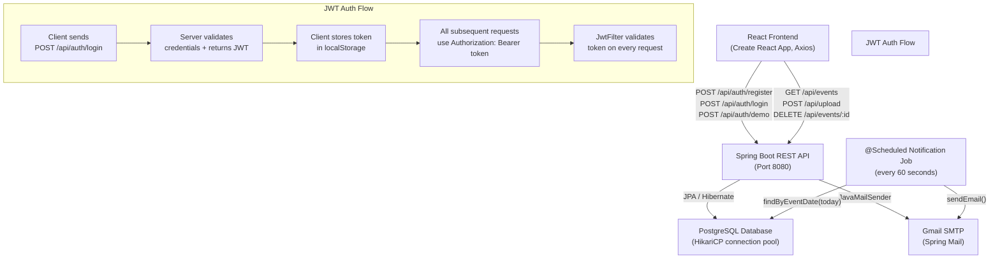

# TimeAlert

> **Smart timetable reminders, right in your inbox.**

TimeAlert is a full-stack web application that lets students and professionals upload their class or work timetable (CSV, Excel, or PDF) and automatically receive email reminders at 30, 20, and 10 minutes before each event starts. Users authenticate with a secure JWT-based account, manage their schedule from a clean React dashboard, and can try the app instantly via a no-signup guest demo.

---

## Features

- **Account authentication** — Register and log in with email + password (bcrypt-hashed, JWT sessions)
- **Guest demo mode** — One-click "Try the demo" with pre-seeded sample events; no signup needed, no real emails sent
- **Timetable upload** — Parse and import events from **CSV**, **Excel (.xlsx/.xls)**, or **PDF** files (up to 10 MB)
- **Automated email reminders** — `@Scheduled` job fires every minute; sends Gmail SMTP notifications at 30 min, 20 min, and 10 min before each event
- **Live schedule dashboard** — Events grouped by date with live status badges (Ongoing / Starts in Xm / Completed)
- **Search & filter** — Real-time search across title, location, and description
- **Dark mode** — Persisted in `localStorage`
- **Per-event deletion** — Delete individual events or clear the entire schedule
- **Rate limiting** — 30 req/min on auth/upload endpoints, 120 req/min on all other API paths
- **Security hardening** — CORS environment-variable driven, JWT fail-fast on weak secret, formula-injection sanitization on file uploads, JSON 401 responses

---

## System Architecture



---

## Tech Stack

| Layer | Technology |
|-------|-----------|
| **Frontend** | React 19, Axios, Lucide React icons, Create React App |
| **Backend** | Spring Boot 3.5, Spring Security, Spring Data JPA, Spring Mail |
| **Authentication** | JWT (JJWT 0.11.5), BCrypt password hashing |
| **Database** | PostgreSQL (migrated from MySQL) |
| **File Parsing** | Apache Commons CSV, Apache POI (Excel), Apache PDFBox 3.x (PDF) |
| **Email** | Gmail SMTP via Spring Mail (`spring-boot-starter-mail`) |
| **Deployment (Frontend)** | Vercel (`vercel.json` configured) |
| **Deployment (Backend)** | Any JVM host (Render, Railway, Heroku) via environment variables |
| **Build Tools** | Maven Wrapper (`mvnw`), npm |

---

## Local Setup

### Prerequisites

- Java 17+
- Node.js 18+ and npm
- PostgreSQL running locally (default: `localhost:5432`)

### 1. Clone the repository

```bash
git clone https://github.com/your-username/time-alert-app.git
cd time-alert-app
```

### 2. Configure the backend

```bash
cd backend
cp .env.example .env
```

Edit `backend/.env` and fill in your values:

```env
DB_URL=jdbc:postgresql://localhost:5432/timealert
DB_USERNAME=postgres
DB_PASSWORD=your_postgres_password

PORT=8080
ALLOWED_ORIGINS=http://localhost:3000

# Generate with: openssl rand -hex 32
JWT_SECRET=your_64_char_random_secret_here

# Gmail App Password (https://myaccount.google.com/apppasswords)
MAIL_USERNAME=your-gmail@gmail.com
MAIL_PASSWORD=xxxx xxxx xxxx xxxx
```

> **Note:** `JWT_SECRET` **must** be set to a strong random value — the app will refuse to start if the known default placeholder is used.

### 3. Create the database

```sql
-- In psql or pgAdmin:
CREATE DATABASE timealert;
```

Hibernate auto-creates tables on first run (`ddl-auto=update`).

### 4. Run the backend

```bash
# From the backend/ directory:
.\mvnw spring-boot:run        # Windows
./mvnw spring-boot:run        # macOS / Linux
```

The API will be available at `http://localhost:8080`.

### 5. Configure the frontend

```bash
cd ../frontend
cp .env.example .env
```

`frontend/.env` should contain:

```env
REACT_APP_API_URL=http://localhost:8080/api
```

### 6. Run the frontend

```bash
npm install
npm start
```

The app opens at `http://localhost:3000`.

---

## API Endpoints

| Method | Path | Description | Auth Required |
|--------|------|-------------|:---:|
| `POST` | `/api/auth/register` | Register a new account | ❌ |
| `POST` | `/api/auth/login` | Log in, receive JWT | ❌ |
| `POST` | `/api/auth/demo` | Guest demo login (seeded events, no real emails) | ❌ |
| `GET` | `/api/events` | Fetch all events for the authenticated user | ✅ |
| `POST` | `/api/upload` | Upload a timetable file (CSV / Excel / PDF) | ✅ |
| `DELETE` | `/api/events/clear` | Delete all events for the authenticated user | ✅ |
| `DELETE` | `/api/events/{id}` | Delete a single event by ID | ✅ |
| `GET` | `/actuator/health` | Health check (no auth, returns `{"status":"UP"}`) | ❌ |

**All authenticated endpoints** require an `Authorization: Bearer <jwt_token>` header.  
**Rate limits:** auth/upload endpoints — 30 req/min per IP; all other API — 120 req/min per IP. Exceeded requests return `429` with `Retry-After: 60`.

### CSV Upload Format

Headers must be exactly: `Subject,Description,Date,StartTime,EndTime,Location`

```csv
Subject,Description,Date,StartTime,EndTime,Location
Database Lecture,Chapter 5 — Normalization,2026-09-01,09:00,10:30,Room 204
```

Dates: `YYYY-MM-DD`. Times: `HH:MM` (24-hour). Description and Location are optional.

> **Note for PDF uploads:** PDFBox extracts text and splits on commas — field values must not contain commas.


---

## License

This project is licensed under the **MIT License** — see the [LICENSE](./LICENSE) file for details.
